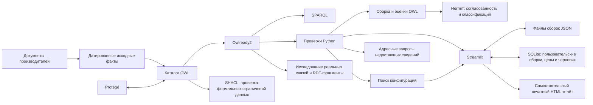

# Методическая основа проекта — версия 2.2

## Тема, проблема и цель

Тема: «Разработка онтологии для интеллектуального подбора компьютерных комплектующих». Совместимость определяется совместным выполнением нескольких условий; совпадение сокета само по себе недостаточно. Пользователю нужны объяснимые причины конфликтов и допустимые способы изменения сборки.

Объект исследования — подбор компонентов персонального компьютера. Предмет — представление знаний об ограничениях совместимости и их использование при проверке и поиске конфигураций.

Цель — разработать онтологическую модель предметной области и прототип, использующий её для объяснимого подбора. Задачи: выделить понятия, отношения и ограничения; разработать OWL; наполнить учебными и реальными данными с происхождением; реализовать вывод, проверку и поиск; оценить поведение на воспроизводимых сценариях.

## Вопросы к онтологии

| Вопрос | Средство ответа |
|---|---|
| Какие платы поддерживают DDR5? | SPARQL supportsMemory |
| Какие CPU имеют AM5? | SPARQL hasSocket |
| Какая модель CPU поддерживается платой и с какого BIOS? | CPUBoardSupport и источник |
| Есть ли явная неподдержка или только отсутствие сведений? | supportStatus / отсутствие профиля |
| Где опубликована конкретная характеристика и когда сверена? | FactAssertion → SourceDocument |
| Почему сборка конфликтная? | Assessment → Constraint, использованные факты и объяснение |
| Какая конфигурация относится к проверенным в рамках модели? | Вывод VerifiedBuild из состава и закрытого набора PassedAssessment |
| Как исправить несколько конфликтов? | Прикладной поиск по ограничениям с повторной проверкой |
| Соответствуют ли записанные данные обязательным ограничениям? | Валидация SHACL отдельным набором форм |
| Какие сведения мешают завершить проверку выбранной сборки? | Адресный план уточнений по неизвестным правилам |

## Архитектура



OWL — источник фактов; Python — механизм прикладных числовых проверок и поиска; HermiT — механизм проверки логической согласованности и вывода принадлежности к классам. Нейросеть и машинное обучение в алгоритме не используются.

Пользовательская SQLite-библиотека отделена от предметной онтологии. Именованные сборки сохраняются как JSON-снимки и повторно проверяются при загрузке. Цены пользователя не записываются в характеристики производителя. Черновик восстанавливается между сеансами; архивирование обратимо. Печатный отчёт явно отделяет результаты прикладных проверок от запуска HermiT и включает ссылки на источники.

## Проверка качества знаний

В версии 2.2 реализован независимый слой SHACL: ограничения на наличие и число значений, их типы и диапазоны, обязательные источники, допустимые статусы и структуру профилей/оценок. Формы находятся в `ontology/quality-shapes.ttl`; результат экспортируется в стандартном RDF-отчёте SHACL и в прикладном JSON.

Принципиальное различие: OWL использует открытый мир и не объявляет экземпляр противоречивым только из-за отсутствия записанного сокета. SHACL способен зафиксировать нарушение требования «у CPU должен быть явно записан один сокет». При этом отсутствие необязательного измерения пиковой мощности не считается нарушением формы, но сохраняет неизвестный результат энергетической проверки.

При валидации используется локальный RDFS-вывод для проверки иерархии классов. Это не запуск HermiT. Для связи сборки с оценками форма допускает прямое hasAssessment и обратное assessesBuild, так как Owlready2 может сериализовать одну сторону обратной связи.

Покрытие происхождением показывает наличие записи утверждения/источника по свойству; для связей кулер–CPU учитывается каждое значение. Показатель не является доказательством достоверности опубликованной характеристики. Даты сверки дополнительно анализируются как календарные значения, отдельно от формальных SHACL-нарушений. Ссылки не посещаются автоматически.

Графовый просмотр использует реальные отношения загруженной онтологии, ограниченную глубину и предел числа узлов. Один и тот же набор троек используется для диаграммы, таблицы и скачиваемого RDF-фрагмента; обрезка не скрывается.

## Модель знаний

Категории CPU, Motherboard, RAM, GPU, PSU, Case, Storage, Cooler — непересекающиеся подклассы Component. Сокет, тип DDR, форм-факторы платы/БП/памяти и интерфейс накопителя представлены самостоятельными понятиями и экземплярами стандартов.

CPUBoardSupport реализует n-арное отношение CPU–плата–минимальный BIOS–статус–источник. Реальные метки BIOS строковые. Отсутствие профиля даёт неизвестность; явно отрицательный профиль — конфликт. В учебном наборе есть один пример явного отрицательного сведения.

SourceDocument хранит издателя, URL и дату сверки. FactAssertion связывает компонент, имя свойства, значение и источник. Для многозначной связи совместимости кулера и CPU создаются утверждения с источником каждого конкретного значения. Пользовательские цены в экспортированной сборке имеют отдельный источник и тип user_input.

Assembly содержит выбранные компоненты. Assessment ссылается на сборку, Constraint, участвующие компоненты, исходные FactAssertion, источники и текст объяснения. Статусы PassedAssessment, FailedAssessment, UnknownAssessment непересекаются.

Примеры аксиом:

```text
CPU ⊓ Motherboard ⊑ ⊥
Functional(hasSocket)
DifferentIndividuals(AM4, AM5, LGA1700)
DDR5Board ≡ Motherboard ⊓ ∃ supportsMemory.{DDR5}
DualStandardCPU ≡ CPU ⊓ ∃ supportsMemory.{DDR4} ⊓ ∃ supportsMemory.{DDR5}
ConflictedBuild ≡ Assembly ⊓ ∃ hasAssessment.FailedAssessment
UncertainBuild ≡ Assembly ⊓ ∃ hasAssessment.UnknownAssessment
VerifiedBuild ≡ PopulatedBuild ⊓ ∃ hasAssessment.PassedAssessment
                ⊓ ∀ hasAssessment.PassedAssessment
```

Состав и оценки экспортированного снимка локально замыкаются. Без замыкания открытый мир не позволяет считать отсутствие отрицательной оценки доказательством её невозможности. HermiT классифицирует результаты, ранее вычисленные Python; он не является независимым источником этих результатов.

## Проверки и неопределённость

Каждое правило даёт pass/fail/unknown. Любой fail определяет конфликтный итог. При отсутствии fail неизвестные обязательные условия дают unknown. Полная сборка со всеми применимыми pass получает pass в пределах модели.

Ноль — известное значение. Неизвестная цена не считается бесплатным компонентом; неизвестная мощность не считается нулевой нагрузкой. TDP и паспортное потребление сохраняются отдельно от пиков, NSPR не преобразуется в ватты.

Режим встроенной графики допускает семь категорий при подтверждённых iGPU CPU и выходах платы. Точная длина M.2 проверяется по списку номинальных креплений; объединённый список не заменяет будущую проверку конкретного слота и разделяемых ресурсов.

## Поиск и исправление

Поиск с возвратом и отсечениями строит конфигурацию по частям. Ветка отклоняется при подтверждённом конфликте; в строгом режиме — также при неизвестном условии, все участники которого уже выбраны. Для бюджета используется нижняя оценка стоимости оставшихся категорий. Финальная конфигурация повторно оценивается тем же валидатором.

Цели: минимум стоимости, минимум числа замен, максимум числа ядер либо объёма RAM с последующим сравнением стоимости. Подтверждённый результат приоритетнее неизвестного. Число замен считается по категориям компонентов; обновление BIOS не предлагается как самостоятельная ремонтная операция.

Фиксация деталей ограничивает пространство поиска. Ограничения времени/узлов не скрываются. Завершённый поиск может подтвердить оптимум в своём конечном каталоге; остановленный возвращает только найденные варианты. Неизвестные цены исключают компонент из поиска по стоимости или бюджету.

## План оценки

Оценка разделена на четыре части:

1. **Логическая:** HermiT подтверждает согласованность исходной модели, выводит классы компонентов/сборок; намеренное присвоение CPU непересекающегося класса платы обнаруживается как противоречие.
2. **Поведенческая:** тесты границ BIOS, бюджета, мощности, форм-факторов, неизвестных значений и импорта.
3. **Поисковая:** результаты небольшой области сравниваются с исчерпывающим перебором; отдельно проверяются минимальные две замены и невозможный бюджет.
4. **Сценарная:** 20 заранее размеченных учебных и реальных случаев; сохраняются ожидаемый/полученный статус, число конфликтов, неизвестных и подтверждений. Есть сравнение с упрощённым алгоритмом, проверяющим только равенство сокета.
5. **Качество данных:** корректный каталог и неполная сборка проходят формы; отсутствие обязательного сокета, отрицательный номинал БП и факт производителя без URL обнаруживаются как нарушения. Отдельно проверяются неполное происхождение, будущие/старые/неверные даты, границы фрагмента графа и адресные запросы.

Результаты: `docs/evaluation/results.json` и `scenarios.csv`. Повтор: `python -m pc_ontology.evaluation`. Это спроектированные проверочные сценарии, не независимая выборка покупок. Процент совпадения нельзя объявлять точностью на всём рынке комплектующих. Измеряемые время/узлы относятся только к этому набору и среде.

## Демонстрация на защите

1. Загрузить совместимую учебную сборку (91 000 учебных рублей, минимум БП 413 Вт по принятой формуле).
2. Поставить DDR4-память и БП Volt400: показать разные конфликты.
3. В «Автоподбор и исправление» выбрать минимальное число замен, зафиксировать остальные детали и получить план из двух замен.
4. Найти самую дешёвую полную учебную сборку при бюджете 80 000.
5. Открыть реальный каталог, карточку характеристики и официальный источник. Показать, почему неизвестные BIOS/пик мощности не считаются подтверждёнными.
6. Экспортировать конфигурацию в OWL и открыть в Protégé. Показать Assembly, Assessment, usesFact и источник.
7. Запустить HermiT: показать выведенный класс текущей сборки и согласованность модели.
8. Представить таблицу оценки и ограничения применимости.
9. Во вкладке «Качество данных» проверить каталог и показать отдельные результаты: структура SHACL, наличие записей происхождения и даты сверки.
10. Открыть фактический граф для компонента или источника, затем показать список уточнений для неполной реальной сборки.

## Структура будущего отчёта

Введение → анализ предметной области → проектирование онтологии и competency questions → реализация слоёв → поиск и объяснения → тестирование и оценка → ограничения и развитие → источники → приложения.

Следующие исследовательские шаги: независимый размеченный набор реальных сборок, расширение до нескольких накопителей и конкретных слотов, сопоставление каждого значения с содержимым первоисточника, подтверждённые измерения производительности, версия и происхождение каждого обновления каталога.

Формальные источники: [W3C SHACL](https://www.w3.org/TR/shacl/) и [документация реализации pySHACL](https://github.com/RDFLib/pySHACL). Используются базовые ограничения SHACL и один локальный SPARQL-контроль происхождения; SHACL-JS, внешние импорты и произвольные пользовательские запросы не включены.
